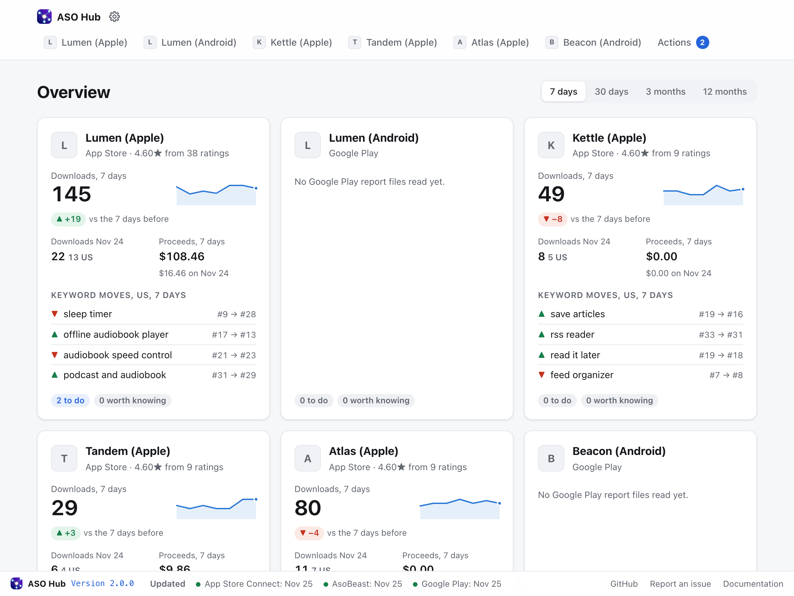
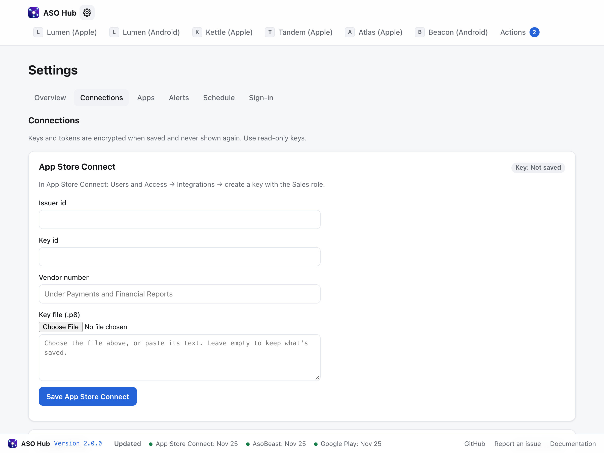

# ASO Hub

One private page for how your apps are found and doing in the stores:
downloads, proceeds, impressions, page views, deletions, rankings, competitors,
keyword coverage, ratings, and one list of what to do next. It reads
[AsoBeast](https://github.com/AsoBeast/asobeast) (rankings; it does not rebuild
them), App Store Connect and Google Play, saves everything it reads, and shows
it on a single self-hosted page. It can post new to-dos and a weekly crash
digest to Discord.


Shared as-is under the MIT license. Issues are welcome; there is no promise of
support or a roadmap. It was built for one small team's apps, so expect rough
edges outside that setup.



## Quick start

Save [`docker-compose.yml`](docker-compose.yml) in a folder, then:

```sh
docker compose up -d
docker logs aso-hub        # shows your setup code
```

1. Open http://127.0.0.1:8690, enter the setup code and choose a password.
2. **Settings → Connections:** add your App Store Connect key, Google Play key
   and AsoBeast token, and press **Test** on each. Use any you have.
3. **Settings → Alerts:** paste a Discord webhook if you want messages.
4. **Settings → Schedule:** set your time zone, then **Pull now**.

Every app you track in AsoBeast appears by itself. There are no files to edit.

The image is
[`liftbridgelabs/aso-hub`](https://hub.docker.com/r/liftbridgelabs/aso-hub), for
Intel/AMD and ARM machines. To update: `docker compose pull && docker compose up -d`.
The version you are on shows at the bottom of every page.

| Image tag | What you get |
|---|---|
| `latest` (default) | The newest release |
| `2.0.0` and other numbers | That release, until you change it |
| `dev` | The newest code, rebuilt on every change after its tests and scans pass. It isn't released yet, so expect rough edges; back up the data folder first, since going back to an older version isn't tested |

To follow `dev`, start with `ASO_HUB_VERSION=dev docker compose up -d`, or change
the image line.

**Opening it from other machines.** In `docker-compose.yml`, change the port line
to `"8690:8690"`. An IP address such as `http://192.168.1.20:8690` then works.
For a name (`https://hub.example.com`), set `ASO_HUB_URL` to it. Across the
internet, use HTTPS through a reverse proxy or tunnel.

**AsoBeast on the same machine:** add its Docker network to the service, and
enter its address under Settings → Connections.

## Settings

The gear beside the name.

| Page | What you set |
|---|---|
| Connections | Apple and Google keys, ids, AsoBeast address and token |
| Apps | Add, rename or hide apps, choose markets |
| Alerts | Discord webhooks, alert rules, the weekly crash digest, hidden keywords |
| Schedule | When it pulls and sends the digest, in your time zone; run now |
| Sign-in | Password, two-step sign-in, single sign-on |



Store numbers need the app to be in your own App Store Connect or Play account;
hide any that aren't yours.

## Sign-in

- **Account.** One owner account, created with the setup code from the log.
- **Two-step sign-in.** A code from an authenticator app (set up by QR code),
  with ten one-time recovery codes.
- **Single sign-on** with any OpenID Connect provider (Pocket ID, Authentik,
  Authelia, Google and others): create a client there with the redirect address
  the page shows, add it, list who may sign in (addresses or `@domain`), and
  press **Try it**. Your provider handles its own two-step sign-in.
- **Cloudflare Access:** set `CF_ACCESS_AUD` and `CF_ACCESS_TEAM_DOMAIN` and the
  hub trusts Access's signed pass instead of asking for a password.
- **Locked out?** On the server:
  `docker exec -it aso-hub python -m aso_hub reset-password`, or
  `... turn-off-two-step`.

## Security

- **Your data stays with you.** There is no hosted service: the hub runs on your
  machine and talks only to Apple, Google, your AsoBeast, your sign-in provider
  and your Discord webhooks. Pages also load app icons from the stores.
- **Nothing is visible without signing in.** Ten wrong tries pause sign-in for 15
  minutes (behind a proxy, everyone shares one address).
- **Read-only access.** Use an App Store Connect key with the Sales role, a Play
  service account with view permissions and a read-only AsoBeast token. The hub
  never changes a listing.
- **Saved keys** are encrypted and never shown again; they can only be replaced
  or removed. The encryption key is `SECRET_KEY`, or a file the hub makes beside
  its database. A copied database is useless without it, but anyone with
  administrator access to the server can get both. To keep backups of the data
  folder safe too, set `SECRET_KEY` and store it elsewhere. If the server is ever
  compromised, revoke every key and webhook.
- **Other websites can't act for you:** changes are accepted only from the hub's
  own pages, and it answers only to IP addresses, `localhost`, the host in
  `ASO_HUB_URL` and names in `ASO_HUB_ALLOWED_HOSTS` (against DNS rebinding).
- **Locked-down container.** No root, read-only filesystem, no extra capabilities.
- A password sent over plain HTTP can be read on the network. Use HTTPS from
  anywhere you don't trust, and don't publish the port straight to the internet.

Found a security problem? Report it privately under the repository's
**Security** tab, not in a public issue.

## Upgrading from 1.x

Your existing `docker-compose.yml`, `config.toml` and secret files keep working;
anything you then save in the app takes their place.

- The first visit asks you to create an account (unless Cloudflare Access signs
  you in). A `hub-password` secret file from 1.1 or 1.2 becomes the account's
  password.
- The hub now pulls and sends the crash digest itself (07:00 and 13:00 UTC,
  digest Mondays 08:00, until you change them). **Remove the timers or cron jobs**
  you set up for `collect` and `crash-digest`, or set `ASO_HUB_SCHEDULER=off` to
  keep yours.
- `ASO_HUB_BEHIND_SIGN_IN` is no longer used.

**Changing to the new `docker-compose.yml`** isn't needed. If you want to, note
that it keeps the database in a Docker volume named `aso-hub-data`, not in your
`./data` folder, and would start empty. Copy the old data (the database and
`secret.key`) across first, from the folder with your old compose file:

```sh
docker compose down
docker run --rm --user 0 -v "$PWD/data:/from:ro" -v aso-hub-data:/to \
  liftbridgelabs/aso-hub:latest sh -c 'cp -a /from/. /to/ && chown -R 1001:1001 /to'
```

Then put the new file in place and run `docker compose up -d`. The new file
doesn't mount `config.toml` or `secrets/`: enter those under Settings, or add the
mounts and their variables to it. Keep `./data` until you've checked the new one.

## Pages

Every page takes a time range: 7 days, 30 days, 3 months or 12 months
(`?days=7|30|90|365`), compared with the range before it.

The top bar shows each app with its store icon (from AsoBeast) and the open
to-do count; light and dark follow the device setting. Style and script links
carry a fingerprint of their contents, so a deploy never leaves a browser on an
old stylesheet.

- **Overview**: per app, downloads for the range with a trend line, the
  latest day's downloads (and the US share), proceeds, the rating, crashes for
  Android, the biggest keyword moves of
  the week in the app's first market, and open to-dos and FYIs.
- **App page**: funnel (impressions → page views → downloads), downloads,
  proceeds, deletions, charts of downloads, impressions, page views and
  proceeds over the range (one measure per chart, hover or tab to a column for
  its value), and a table by day (up to 30 days), week (3 months) or
  month (12 months). Then actions, ratings and recent reviews, and per market a
  keyword table (position, 7-day move, popularity, difficulty, competitors
  ahead, where it is in the listing) and the listing text with character counts.
- **Actions**: "To do" (things to act on: hub rules and AsoBeast's Action
  Center, with a link to AsoBeast to snooze or dismiss) and "Worth knowing"
  (nothing to do about it directly, like low downloads).


A bar at the bottom shows the version, when each source was last read and links
to this project. A failed pull shows a banner with the reason.

## Where the numbers come from

| Number | Source | Notes |
|---|---|---|
| First-time downloads | Sales and Trends daily report **and** the App Downloads analytics report | The larger of the two each day, as ASO Atlas does: each misses some on some days. Sales units are product types 1, 1F, 1T, F1 and the 1E variants; updates and in-app purchases are left out. |
| Impressions, page views | App Store Discovery and Engagement report | Pages show total counts (what App Store Connect and ASO Atlas show). The page-view spike rule uses unique devices, so one person reloading the page isn't a spike. |
| Deletions | App Store Installation and Deletion report | Can end a day earlier than the impressions report. |
| Proceeds | App Store Purchases report, `Proceeds in USD` | Apple's own dollar figure. ASO Atlas differs by a few cents on some days ($2.83 vs $2.78), probably its own currency rates. |
| Conversion | downloads ÷ impressions | Same as App Store Connect and ASO Atlas. |
| Android installs, uninstalls, devices | Play report files, `stats/installs/..._overview.csv` (and `_country.csv` for US) | "Installs" is Daily User Installs (new people, not devices). About 4 days behind. UTF-16 files. |
| Android store listing visitors, installed | `stats/store_performance/..._country.csv` | Visitors and "acquisitions" (visitors who installed), summed over countries; Google lumps small numbers into "Other", so a small app has no country or search-term split yet. About 6 days behind. |
| Android in-app purchases | `sales/salesreport_YYYYMM.zip` | Orders counted per day ("Charged"); refunds counted separately. In the buyer's currency, so the hub counts them rather than converting. |
| Android earnings | `earnings/earnings_YYYYMM_*.zip` | Monthly, in US dollars after Google's fee, published early the next month. |
| Android crashes and ANRs | Play Developer Reporting API, `errorIssues:search` | Google computes no daily crash or ANR rate for an app with few users (a small app's comes back empty), so the hub reads the issues themselves. Daily rates lag about 9 days when they do exist. |
| Android crash and ANR counts by version (weekly digest) | Play Developer Reporting API, `errorCountMetricSet:query` | Report counts per Pacific day and version code. Unlike rates, these come back for small apps. About a day behind; asking past Google's latest day is refused, so the digest stops there and says so. |
| iOS crashes by version (weekly digest) | App Crashes analytics report | See "Weekly crash digest" for what Apple leaves out. |

**Google Play** is read with a Google Cloud service account that you add as a
user in Play Console with two account permissions: "View app information and
download bulk reports (read-only)" and "View financial data". The reports
bucket (`gs://pubsite_prod_<id>`, shown under Download reports in Play Console)
holds installs, store visitors, sales and earnings; Google can take a day or
two to open it to a new account. Enter the bucket name under Settings → Connections.

Checked against ASO Atlas for one ten-day stretch: downloads, impressions,
page views and deletions matched every day.

Things learned building it:

- **Apple restates each day in the next day's analytics file.** The hub keeps
  every file and counts only the newest one covering a day (`asc_current` in
  `db.py`). Adding them up double counts.
- **Apple keeps about 31 days of daily analytics files** and a year of daily
  sales reports, so the hub's database is the only long-term copy. Nothing is
  deleted. The first pull reads the whole year of sales (about 4 minutes).
- **The Sales-role key is enough.** It lists and reads the ongoing report
  requests ASO Atlas created; no Admin key. The hub never creates requests (a
  second create fails with 409).
- Report files download from Amazon S3 (`*.s3.us-west-2.amazonaws.com`), not
  from Apple's API host.

## AsoBeast

Read over HTTP with a read-only token, built against AsoBeast 1.13.0.
Each pull saves the answers as that day's snapshots (`asobeast_snapshots`), all
at once, so a failed pull leaves the last good day. Apps are matched by store id.

- **Hidden keywords**: AsoBeast re-adds single words from the title, subtitle
  and keyword field every day (`source` TITLE, SUBTITLE or KEYWORD_FIELD). The
  keyword tables hide those unless you list them under Settings → Alerts; "show all" brings them back. Keywords you added (MANUAL)
  always show.
- **"In the listing"**: AsoBeast counts a phrase as covered only when one field
  holds all of it, but Apple combines words across the title, subtitle and
  keyword field. So when no field holds the phrase, the hub checks each word
  against the fields the store searches (AsoBeast's `indexed` flag; the App
  Store doesn't search the description) plus the keyword fields of the other
  languages the market reads (the US store also reads Spanish (Mexico)), and
  names any missing word.
- **Visibility for the Monday post**: `/portfolio` and `/portfolio/insights`
  give each app's visibility and listing audit score with their 7-day change,
  and the same visibility for a linked group (one app on both stores).
  `report-snapshot` prints them as JSON for a daily-report script of your own.

## Rules

Switch rules on or off and change thresholds under Settings → Alerts. An action opens the first
pull a rule fires, keeps its "since" date while it keeps firing, and resolves
the first pull it doesn't.

To do:
- A Google Play crash or ANR reported in the last 7 days (high if it hit 3+
  users), with a link to it in Play Console.
- A keyword whose usual spot the week before (the middle of its 7 checks) was
  in the top 50 sits 15+ places below that on each of the last 3 checks (hidden
  single words don't count). The usual spot, not the best day, so a search that
  swings 40 places a day doesn't raise a false alarm.
- Deletions above 50% of first-time downloads over 14 days (needs 10 downloads).
- A review from the last 7 days with no reply (says where to reply).

Worth knowing:
- US first-time downloads average below a per-app minimum over 7 days (example: 3
  for one app), with any US keywords that fell 10+ places in the same days as a likely cause.
- Page viewers at least 3x normal (and 20+) with no matching rise in downloads.
- A new rating in the last 3 days.

**Discord:** after each pull, new to-dos (hub rules and open AsoBeast items)
post to the "New to-dos" Discord webhook (one message, or more if
it runs past Discord's length limit), with a link to the Actions page. Each
posts once, and again only if it resolves and comes back. "Worth knowing" and snoozed AsoBeast items don't post. A failed
post is retried on the next pull. With no webhook saved, nothing posts.

## Weekly crash digest

One message per app you tick under Settings → Alerts, to a Discord channel of
your choice. It covers the last full week (Monday to Sunday) against the week
before: crashes by app version on iOS, crashes and freezes (ANRs) by version code
on Android, and the week's top Android issues with a link to each in Play
Console. A week with nothing says "No crashes reported", so a missing message
means the job didn't run. iOS and Android of the same app share a message. A
failed pull is said in the message; that, a failed post, or a ticked app with no
webhook also posts to the "When a crash digest fails" webhook. Each app posts
once per week.

**What Apple's numbers include (checked Nov 2026).** The only crash source
the hub's Sales-role key can read is the App Crashes analytics report, in the
ongoing report request each app already has. Apple fills it only from people
who share analytics with developers (in one app's App Opt In report, 5 of 7
downloading users), and only once at least 5 of them crash, so a
small app's report is usually empty: none of the four iOS apps we tried had a single
App Crashes file in Apple's 31-day window. A day can still grow for 5
days after it ends. The report has no crash causes or logs; those are in Xcode's
Organizer (Window > Organizer > Crashes), which has no API. The other Apple
sources were tried with the same key: the performance metrics
(`/v1/apps/{id}/perfPowerMetrics`) answer but are empty for apps this size, and
build diagnostics (hangs, slow launches) and TestFlight crash feedback answer
403 to a Sales key. Google counts every crash its users' phones report, with no
minimum.

## Settings in files (optional)

Everything above can also come from files and environment variables, which the
app's Settings override: `config.toml` (`HUB_CONFIG`) for apps and rules;
`ASC_ISSUER_ID`, `ASC_KEY_ID`, `ASC_VENDOR_NUMBER`, `ASC_KEY_PATH`,
`GOOGLE_KEY_PATH`, `PLAY_BUCKET`, `ASOBEAST_URL`, `ASOBEAST_WEB_URL`,
`ASOBEAST_TOKEN_FILE`, `DISCORD_WEBHOOK_FILE`, `ALERTS_WEBHOOK_DIR`
(`alerts-<app>` files). Others: `ASO_HUB_URL`, `ASO_HUB_ALLOWED_HOSTS`,
`SECRET_KEY`, `SETUP_TOKEN` (your own setup code), `ASO_HUB_SCHEDULER=off`,
`DATABASE_PATH`, `HOST`, `PORT`.

## Development

```sh
python3.13 -m venv .venv && .venv/bin/pip install -r requirements-dev.txt
.venv/bin/python -m aso_hub serve            # http://127.0.0.1:8690
.venv/bin/ruff check . && .venv/bin/pytest -q
```

To look around with made-up numbers (as in the screenshots):
`python demo/seed.py /tmp/demo.db`, then
`HUB_CONFIG=demo/config.toml DATABASE_PATH=/tmp/demo.db ASO_HUB_SCHEDULER=off python -m aso_hub serve`.

## Checks

- `security.yml`: gitleaks over the full history, pip-audit and OSV-Scanner on
  `requirements.txt`, on every push and weekly.
- `tests.yml`: ruff and pytest on every push.
- `release.yml`: a version tag builds, starts and publishes the image, after the
  tests and scans pass.
- Dependabot update pull requests (`dependabot.yml`).
- `requirements.txt` pins every library, indirect ones too, so the image ships
  exactly what was scanned.

## License

MIT, see `LICENSE`.
